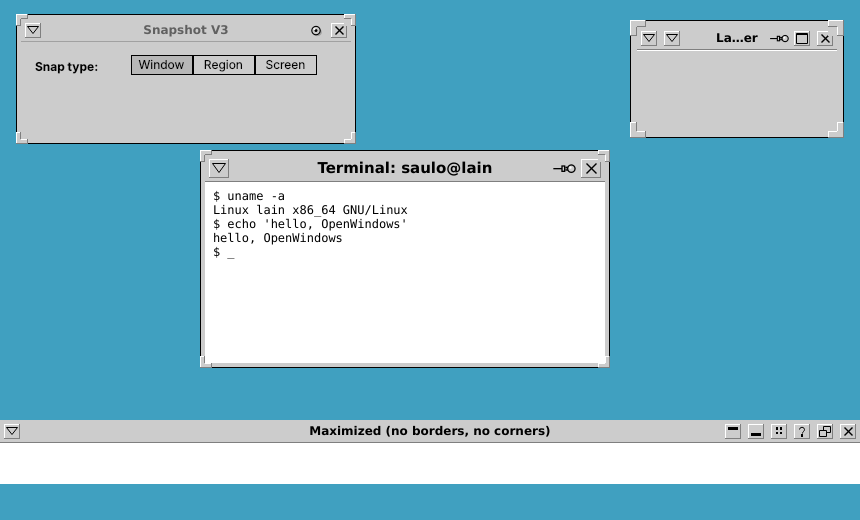
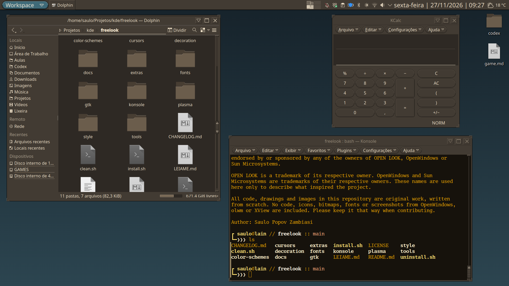

# FreeLook

*Read in English: [README.md](README.md)*

Um tema para o KDE Plasma 6 inspirado no **OPEN LOOK**, o visual do
OpenWindows da Sun. Um retrofuturismo para o desktop livre: os widgets 3D
cinzentos, os botões oblongos, os pushpins e as barras de rolagem "elevador"
de 1991, rodando num Plasma moderno.


## Por que FreeLook

Em janeiro e fevereiro de 1997, fiz duas disciplinas no IMPA, no Rio de
Janeiro, como aluno especial: computação gráfica e matemática. Os laboratórios
tinham estações da Sun com o OpenWindows. Nelas eu navegava, lia meus e-mails
e conversava no IRC por um terminal de texto. Eu vinha do DOS, do Windows e de
um pouco de Minix para programar em C, e achei aquele ambiente muito bonito.
De volta para casa, quis ter aquilo de verdade, e instalei o Linux.

O FreeLook é um caminho de volta àquele desktop, sobre o sistema livre ao qual
ele me levou.

*Saulo Popov Zambiasi*

## O que vem no pacote

| Peça | O que faz | Tecnologia |
|---|---|---|
| **Decoração de janela** | Borda fina com contorno preto, cantos de redimensionamento em L em relevo, botão de menu com triângulo vazado, título centralizado com separador entalhado, pushpin | Aurorae do KWin, QML |
| **Estilo dos programas** | Botões oblongos com anel no botão padrão, setas vazadas, ✓ que transborda da caixinha, opções exclusivas retangulares, abas desenhadas como opções exclusivas, campos de texto sublinhados, campos numéricos com as caixinhas [▲][▼], combos como botões de menu, sliders com o bloquinho de arrastar, menus em que o item escolhido afunda, a barra de menus com botões de menu e a barra de rolagem **elevador** do OPEN LOOK | Plugin `QStyle` do Qt 6, C++ |
| **Tema GTK 3** | O mesmo visual nos programas em GTK 3 (Firefox, GIMP, Inkscape, LibreOffice e outros): botões oblongos, campos sublinhados, o ✓ que transborda, opções exclusivas, abas, menus, sliders e uma barra de rolagem parecida com o elevador | CSS do GTK 3 |
| **Cursores** | Ponteiros originais no espírito do OPEN LOOK: formas pretas com contorno branco, uma seta esguia, um cronômetro enquanto espera | Cursores SVG do Plasma 6 e Xcursor |
| **Fontes** | A família Go, da Bigelow & Holmes, os desenhistas da Lucida (a fonte do OpenWindows): Go na interface, Go Bold no título das janelas, Go Mono na largura fixa | TrueType, BSD 3-Clause |
| **Estilo do Plasma** | Painel, menus, dicas e plasmoides com a moldura das janelas pop-up do OPEN LOOK, botões oblongos, seleção afundada | Tema SVG do Plasma |
| **Esquema de cores** | A paleta do OpenWindows 3: `#cccccc`, `#b7b7b7`, `#a0a0a0` e branco | Esquema de cores do KDE |
| **FreeLook Noturno** | Uma variante noturna em âmbar, como um terminal antigo à noite (base `#423b33`, texto creme): esquema de cores, estilo do Plasma, tema global, tema GTK 3 noturno e papel de parede noturno. Escolha FreeLook e FreeLook Noturno como temas claro e escuro para alternar entre eles, à mão ou automaticamente | Esquema de cores, estilo do Plasma e tema global do KDE, CSS do GTK 3 |
| **FreeLook Âmbar** | Um esquema de cores para o Konsole como um terminal de fósforo âmbar: os detalhes se distinguem pelo brilho, do laranja forte ao creme. Escolha no Konsole em *Configurações > Editar o perfil atual > Aparência* | Esquema de cores do Konsole |
| **Tema global** | Aplica tudo isso de uma vez, inclusive a ordem dos botões da barra de título | Pacote de tema global do Plasma |
| **Papel de parede** | O azul do OpenWindows, `#40a0c0` | Pacote de papel de parede |
| **Tela de abertura** | Enquanto a sessão inicia: uma janela de aviso do FreeLook sobre o papel de parede, com um cronômetro de ponteiro girando, a etapa atual e uma barra de progresso. Acompanha o dia e a noite | Parte dos temas globais |

### A barra de rolagem elevador

Como no OPEN LOOK, as setas ficam **dentro** do elevador, que tem tamanho
fixo. Clicar no cabo acima ou abaixo rola uma página, as âncoras das pontas
levam ao início e ao fim, e o trecho escuro do cabo mostra quanto do conteúdo
está visível. A seta da ponta onde você já está fica apagada.

### O botão de menu da janela

A caixinha com o triângulo, à esquerda do título, funciona como no olwm:
**clique esquerdo** executa a ação padrão do menu ("Close", que no OPEN LOOK
quer dizer virar ícone, então minimiza) e **clique direito** abre o menu da
janela. O pushpin à direita mantém a janela acima das outras.






O GIMP 3 vem com um tema escuro próprio; escolha *Editar → Preferências →
Interface → Tema → System* para ele usar o FreeLook.

## Requisitos

- KDE Plasma 6 (desenvolvido no Plasma 6.8 com Qt 6.11; o estilo compila com Qt 6.4 ou mais novo)
- Para compilar o estilo dos programas: CMake, um compilador C++17 e o pacote de desenvolvimento do Qt 6

```sh
sudo dnf install cmake gcc-c++ qt6-qtbase-devel      # Fedora
sudo apt install cmake g++ qt6-base-dev              # Debian / Ubuntu
sudo zypper install cmake gcc-c++ qt6-base-devel     # openSUSE
sudo pacman -S cmake gcc qt6-base                    # Arch
```

A partir do Plasma 6.3, o Aurorae vem num pacote separado. Se a decoração não
aparecer na lista, instale-o (`sudo dnf install aurorae` no Fedora).

## Instalar

Tudo é instalado só para o seu usuário, sem `sudo`.

```sh
git clone <endereço-do-repositório> freelook
cd freelook
./install.sh --apply
```

O `install.sh` copia os arquivos do tema, compila o estilo dos programas,
**roda os testes dele e só instala se todos passarem**, e com `--apply` ativa
o tema global FreeLook, o papel de parede e o tema GTK. Sem o `--apply`, escolha em
*Configurações do Sistema → Cores e Temas → Tema global → FreeLook*, e o FreeLook em
*Estilo dos aplicativos → Configurar estilo dos aplicativos GNOME/GTK*.

**GIMP 3:** escolha o tema *System* em *Editar → Preferências → Interface →
Tema*, e logo abaixo o esquema de cores *Cores do sistema*, para o GIMP
acompanhar o dia e a noite com o FreeLook. O esquema padrão do GIMP é o
escuro, e com ele o GIMP pede o FreeLook Noturno o dia todo.

Na primeira vez, saia e entre de novo na sessão, para todos os programas
acharem o estilo (ele fica em `~/.local/lib/qt6/plugins`, anunciado pelo
`~/.config/plasma-workspace/env/freelook.sh`).

Opções: `--no-style` pula a compilação do C++; `--help` mostra todas.

O tema global também define as fontes (Go, Go Bold nos títulos, Go Mono). Para
manter as suas, escolha-as de novo em *Configurações do Sistema → Texto e Fontes*.

## Desinstalar

```sh
./uninstall.sh
```

Se alguma peça do FreeLook estiver em uso, ele primeiro volta para o tema
global Breeze, o papel de parede padrão e o tema GTK Breeze, e depois remove
todos os arquivos.
Use `--yes` para pular a confirmação. Ele também limpa o que as versões
antigas do FreeLook (em português) instalaram.

Para só voltar ao visual padrão sem remover nada, escolha o tema global
**Breeze**.

## Desenvolvimento

O código, os comentários e as mensagens dos scripts estão em inglês, para
facilitar contribuições de qualquer lugar. Os nomes e descrições que aparecem
nas Configurações do Sistema têm tradução para o português.

Para limpar o que a compilação e os testes geram, use `./clean.sh`: ele mostra
o que vai apagar, pede confirmação e nunca mexe nos arquivos do projeto.

Os painéis experimentais (barra em cima, na direita ou nos dois lugares) estão
em `plasma/panels/`. Para testar: `tools/try-panel.sh top-windows` (ou outra
variante); para voltar aos seus painéis: `tools/try-panel.sh --restore`.

Os detalhes de como testar cada peça (a galeria do estilo C++, o ambiente de
teste da decoração QML, os geradores do estilo do Plasma e a galeria do tema GTK) estão no
[README.md](README.md#development).

## Limitações conhecidas

- A barra de rolagem dos pop-ups do Plasma é feita de peças SVG fixas, então
  ali as setas não ficam dentro do elevador. Nos programas, o elevador é completo.
- As listas dentro de janelinhas do Kirigami (QML), como a lista de um combo nas Configurações do Sistema, mantêm o destaque do próprio Kirigami.
- O calendário e alguns outros widgets do Plasma ainda vêm do Breeze.
- Depois de atualizar a decoração das janelas, saia e entre na sessão: o KWin
  mantém a decoração que carregou no login.
- FreeLook Noturno: os programas em GTK, menos o Firefox, só trocam entre dia
  e noite quando reabertos, porque o GTK 3 lê a preferência pelo escuro ao
  iniciar.
- Programas em GTK 4 e libadwaita (a maioria dos aplicativos novos do GNOME)
  mantêm o visual deles: a libadwaita não aceita temas.
- No GTK 3, o ▲ e o ▼ do elevador são só marcas: arraste o elevador ou clique
  no cabo. O GTK não permite setas que funcionem dentro do controle.
- O arquivo de sessão do FreeLook desliga as barras de rolagem sobrepostas do
  GTK 3 (`GTK_OVERLAY_SCROLLING=0`), para o elevador ficar sempre visível.

## Autoria e auxílio de IA

**Um projeto pessoal.** O FreeLook nasceu de uma vontade minha. Eu queria
voltar àquela área de trabalho, alimentar essa saudade, e não achei nada
que me contentasse. Também não tinha tempo para fazer tudo sozinho, então
fiz em parceria com uma IA: eu dei a direção, as referências e as
decisões, testei cada passo na minha máquina, e o Claude escreveu a maior
parte do código.

Sei que o uso de IA é um tema polêmico, inclusive dentro da comunidade do
KDE, e respeito quem pensa diferente. Por isso não publiquei o FreeLook na
KDE Store: ele fica aqui, no GitHub, para quem o encontrar. Se você quiser
experimentar, sabendo de tudo isso, fique à vontade. E se gostar, melhor
ainda.

*Saulo Popov Zambiasi*

O FreeLook foi criado por **Saulo Popov Zambiasi** com o auxílio do
**Claude Opus 5.5**, um modelo de IA da Anthropic, usado pelo claude.ai em
novembro de 2026.

- **Saulo Popov Zambiasi:** a ideia e a direção do projeto; as referências
  visuais do OpenWindows; a primeira tentativa, um tema Kvantum; as decisões
  de design (o OPEN LOOK puro em vez de uma mistura, botões maiores na barra
  de título, um tema global, o código em inglês); e os testes no Plasma de
  verdade, que pegaram problemas que as prévias automáticas não mostravam.
  Ele revisou o trabalho e é o responsável pelo projeto publicado.
- **Claude Opus 5.5:** a maior parte do código (C++, QML, Python e shell),
  os geradores, os testes automáticos e a documentação, sob a direção e a
  revisão do Saulo.

Os commits feitos com auxílio de IA levam a linha
`Co-Authored-By: Claude Opus 5.5 <noreply@anthropic.com>`.
A história completa está no [CHANGELOG.md](CHANGELOG.md) (em inglês).

## Licença

GPL-3.0-or-later. Veja o arquivo [LICENSE](LICENSE).

As fontes Go em `fonts/Go/` são da Bigelow & Holmes, sem modificações, sob a
licença BSD 3-Clause delas ([fonts/Go/LICENSE](fonts/Go/LICENSE)).

### Marcas e originalidade

O OPEN LOOK foi criado pela Sun Microsystems e pela AT&T. O FreeLook é uma
homenagem independente, inspirada nesse design, sem vínculo, aprovação ou
patrocínio de nenhum dos donos do OPEN LOOK, do OpenWindows ou da Sun
Microsystems.

OPEN LOOK é marca registrada do seu respectivo dono. OpenWindows e Sun
Microsystems são marcas dos seus respectivos donos. Esses nomes aparecem aqui
só para descrever o que inspirou o projeto.

Todo o código, os desenhos e as imagens deste repositório são trabalho
original, feito do zero. Nenhum código, ícone, bitmap, fonte ou captura de
tela do OpenWindows, do olwm ou do XView foi incluído. Ao contribuir, por
favor, mantenha assim.

Autor: Saulo Popov Zambiasi
