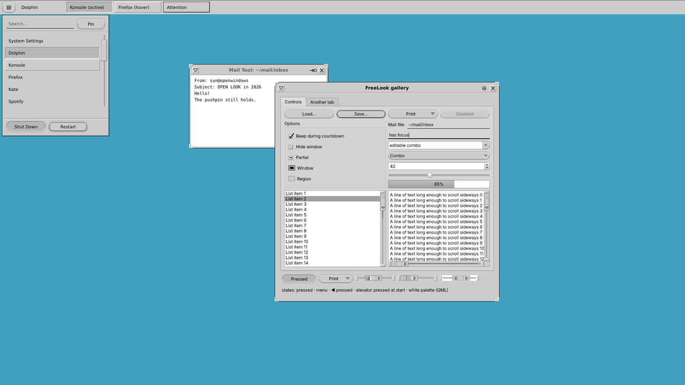

# FreeLook

*Read in English: [README.md](README.md)*

Um tema para o KDE Plasma 6 inspirado no **OPEN LOOK**, o visual do
OpenWindows da Sun. Um retrofuturismo para o desktop livre: os widgets 3D
cinzentos, os botões oblongos, os pushpins e as barras de rolagem "elevador"
de 1991, rodando num Plasma moderno.



## O que vem no pacote

| Peça | O que faz | Tecnologia |
|---|---|---|
| **Decoração de janela** | Borda fina com contorno preto, cantos de redimensionamento em L em relevo, botão de menu com triângulo vazado, título centralizado com separador entalhado, pushpin | Aurorae do KWin, QML |
| **Estilo dos programas** | Botões oblongos com anel no botão padrão, setas vazadas, ✓ que transborda da caixinha, opções exclusivas retangulares, abas desenhadas como opções exclusivas, campos de texto sublinhados, campos numéricos com as caixinhas [▲][▼], combos como botões de menu, sliders com o bloquinho de arrastar, menus em que o item escolhido afunda, a barra de menus com botões de menu e a barra de rolagem **elevador** do OPEN LOOK | Plugin `QStyle` do Qt 6, C++ |
| **Tema GTK 3** | O mesmo visual nos programas em GTK 3 (Firefox, GIMP, Inkscape, LibreOffice e outros): botões oblongos, campos sublinhados, o ✓ que transborda, opções exclusivas, abas, menus, sliders e uma barra de rolagem parecida com o elevador | CSS do GTK 3 |
| **Estilo do Plasma** | Painel, menus, dicas e plasmoides com a moldura das janelas pop-up do OPEN LOOK, botões oblongos, seleção afundada | Tema SVG do Plasma |
| **Esquema de cores** | A paleta do OpenWindows 3: `#cccccc`, `#b7b7b7`, `#a0a0a0` e branco | Esquema de cores do KDE |
| **Tema global** | Aplica tudo isso de uma vez, inclusive a ordem dos botões da barra de título | Pacote de tema global do Plasma |
| **Papel de parede** | O azul do OpenWindows, `#40a0c0` | Pacote de papel de parede |

### A barra de rolagem elevador

Como no OPEN LOOK, as setas ficam **dentro** do elevador, que tem tamanho
fixo. Clicar no cabo acima ou abaixo rola uma página, as âncoras das pontas
levam ao início e ao fim, e o trecho escuro do cabo mostra quanto do conteúdo
está visível. A seta da ponta onde você já está fica apagada.

### O botão de menu da janela

A caixinha com o triângulo, à esquerda do título, funciona como no olwm:
**clique esquerdo** executa a ação padrão do menu ("Close", que no OPEN LOOK
quer dizer virar ícone, então minimiza) e **clique direito** abre o menu da
janela. O pushpin à direita mantém a janela acima das outras.

## Requisitos

- KDE Plasma 6 (desenvolvido no Plasma 6.8 com Qt 6.11; o estilo compila com Qt 6.4 ou mais novo)
- Para compilar o estilo dos programas: CMake, um compilador C++17 e o pacote de desenvolvimento do Qt 6

```sh
sudo dnf install cmake gcc-c++ qt6-qtbase-devel      # Fedora
sudo apt install cmake g++ qt6-base-dev              # Debian / Ubuntu
sudo zypper install cmake gcc-c++ qt6-base-devel     # openSUSE
sudo pacman -S cmake gcc qt6-base                    # Arch
```

A partir do Plasma 6.3, o Aurorae vem num pacote separado. Se a decoração não
aparecer na lista, instale-o (`sudo dnf install aurorae` no Fedora).

## Instalar

Tudo é instalado só para o seu usuário, sem `sudo`.

```sh
git clone <endereço-do-repositório> freelook
cd freelook
./install.sh --apply
```

O `install.sh` copia os arquivos do tema, compila o estilo dos programas,
**roda os testes dele e só instala se todos passarem**, e com `--apply` ativa
o tema global FreeLook, o papel de parede e o tema GTK. Sem o `--apply`, escolha em
*Configurações do Sistema → Cores e Temas → Tema global → FreeLook*, e o FreeLook em
*Estilo dos aplicativos → Configurar estilo dos aplicativos GNOME/GTK*.

Na primeira vez, saia e entre de novo na sessão, para todos os programas
acharem o estilo (ele fica em `~/.local/lib/qt6/plugins`, anunciado pelo
`~/.config/plasma-workspace/env/freelook.sh`).

Opções: `--no-style` pula a compilação do C++; `--help` mostra todas.

Sugestão: uma fonte sem serifa em negrito, perto de 10 pt, para o título das
janelas (*Configurações do Sistema → Texto e Fontes → Título da janela*).

## Desinstalar

```sh
./uninstall.sh
```

Se alguma peça do FreeLook estiver em uso, ele primeiro volta para o tema
global Breeze, o papel de parede padrão e o tema GTK Breeze, e depois remove
todos os arquivos.
Use `--yes` para pular a confirmação. Ele também limpa o que as versões
antigas do FreeLook (em português) instalaram.

Para só voltar ao visual padrão sem remover nada, escolha o tema global
**Breeze**.

## Desenvolvimento

O código, os comentários e as mensagens dos scripts estão em inglês, para
facilitar contribuições de qualquer lugar. Os nomes e descrições que aparecem
nas Configurações do Sistema têm tradução para o português.

Para limpar o que a compilação e os testes geram, use `./clean.sh`: ele mostra
o que vai apagar, pede confirmação e nunca mexe nos arquivos do projeto.

Os detalhes de como testar cada peça (a galeria do estilo C++, o ambiente de
teste da decoração QML, os geradores do estilo do Plasma e a galeria do tema GTK) estão no
[README.md](README.md#development).

## Limitações conhecidas

- A barra de rolagem dos pop-ups do Plasma é feita de peças SVG fixas, então
  ali as setas não ficam dentro do elevador. Nos programas, o elevador é completo.
- As listas dentro de janelinhas do Kirigami (QML), como a lista de um combo nas Configurações do Sistema, mantêm o destaque do próprio Kirigami.
- Interruptores, calendário e alguns outros widgets do Plasma ainda vêm do Breeze.
- Programas em GTK 4 e libadwaita (a maioria dos aplicativos novos do GNOME)
  mantêm o visual deles: a libadwaita não aceita temas.
- No GTK 3, o ▲ e o ▼ do elevador são só marcas: arraste o elevador ou clique
  no cabo. O GTK não permite setas que funcionem dentro do controle.
- O arquivo de sessão do FreeLook desliga as barras de rolagem sobrepostas do
  GTK 3 (`GTK_OVERLAY_SCROLLING=0`), para o elevador ficar sempre visível.

## Autoria e auxílio de IA

O FreeLook foi criado por **Saulo Popov Zambiasi** com o auxílio do
**Claude Opus 5.5**, um modelo de IA da Anthropic, usado pelo claude.ai em
novembro de 2026.

- **Saulo Popov Zambiasi:** a ideia e a direção do projeto; as referências
  visuais do OpenWindows; a primeira tentativa, um tema Kvantum; as decisões
  de design (o OPEN LOOK puro em vez de uma mistura, botões maiores na barra
  de título, um tema global, o código em inglês); e os testes no Plasma de
  verdade, que pegaram problemas que as prévias automáticas não mostravam.
  Ele revisou o trabalho e é o responsável pelo projeto publicado.
- **Claude Opus 5.5:** a maior parte do código (C++, QML, Python e shell),
  os geradores, os testes automáticos e a documentação, sob a direção e a
  revisão do Saulo.

Os commits feitos com auxílio de IA levam a linha
`Co-Authored-By: Claude Opus 5.5 <noreply@anthropic.com>`.
A história completa está no [CHANGELOG.md](CHANGELOG.md) (em inglês).

## Licença

GPL-3.0-or-later. Veja o arquivo [LICENSE](LICENSE).

### Marcas e originalidade

O OPEN LOOK foi criado pela Sun Microsystems e pela AT&T. O FreeLook é uma
homenagem independente, inspirada nesse design, sem vínculo, aprovação ou
patrocínio de nenhum dos donos do OPEN LOOK, do OpenWindows ou da Sun
Microsystems.

OPEN LOOK é marca registrada do seu respectivo dono. OpenWindows e Sun
Microsystems são marcas dos seus respectivos donos. Esses nomes aparecem aqui
só para descrever o que inspirou o projeto.

Todo o código, os desenhos e as imagens deste repositório são trabalho
original, feito do zero. Nenhum código, ícone, bitmap, fonte ou captura de
tela do OpenWindows, do olwm ou do XView foi incluído. Ao contribuir, por
favor, mantenha assim.

Autor: Saulo Popov Zambiasi
