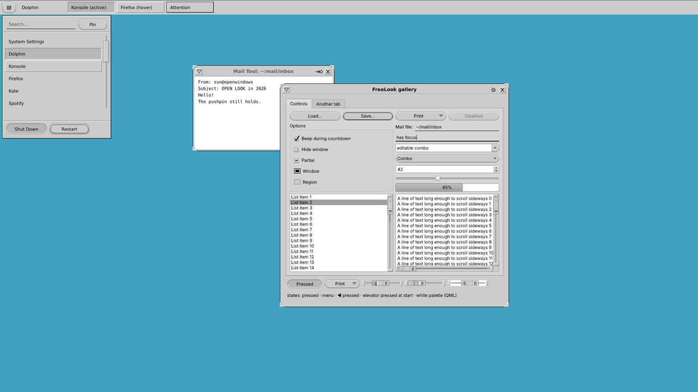
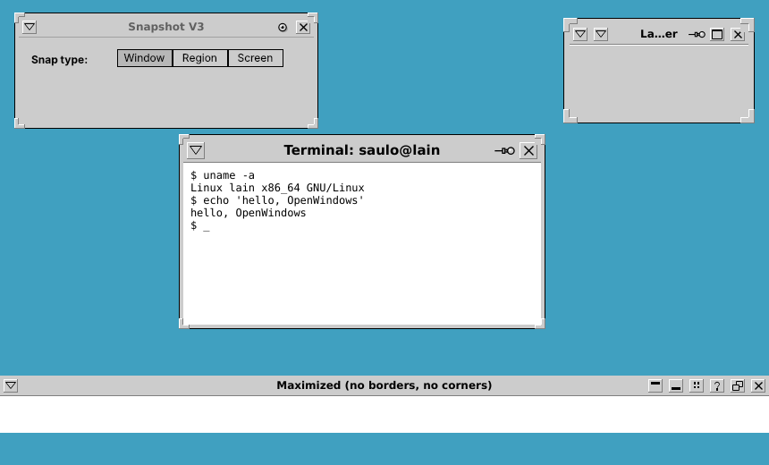
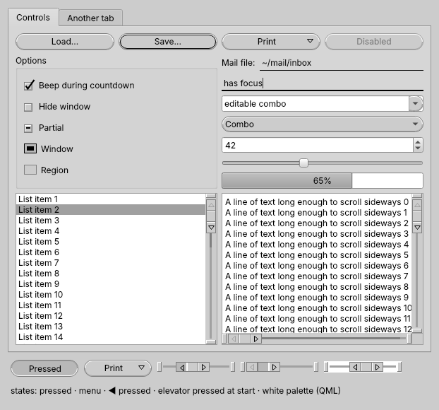
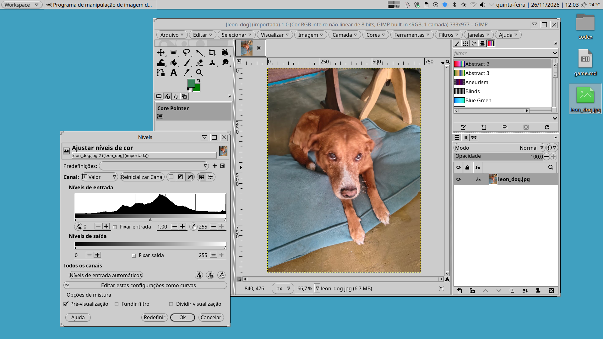

# FreeLook

*Leia em português: [LEIAME.md](LEIAME.md)*

A KDE Plasma 6 theme inspired by **OPEN LOOK**, the look and feel of Sun's
OpenWindows desktop. A retro-future for the free desktop: the gray 3D
widgets, oblong buttons, pushpins and elevator scroll bars of 1991, running
on a modern Plasma.



## Components

| Component | What it does | Technology |
|---|---|---|
| **Window decoration** | Thin black-outlined border, raised L-shaped resize corners, window menu button with a hollow triangle, centered title with an etched separator, pushpin | KWin Aurorae, QML |
| **Application style** | Oblong buttons with a default ring, hollow arrows, check marks that overflow their box, rectangular exclusive settings, tabs drawn as exclusive settings, underlined text fields, numeric fields with [▲][▼] boxes, combo boxes as menu buttons, sliders with a drag box, menus where the chosen item sinks in, menu bar entries as menu buttons, and the OPEN LOOK **elevator** scroll bar | Qt 6 `QStyle` plugin, C++ |
| **GTK 3 theme** | The same look for GTK 3 programs (Firefox, GIMP, Inkscape, LibreOffice and others): oblong buttons, underlined fields, the ✓ that overflows, exclusive settings, tabs, menus, sliders and an elevator-like scroll bar | GTK 3 CSS |
| **Plasma style** | Panel, menus, tooltips and widgets with the OPEN LOOK pop-up window frame, oblong buttons, sunken selection | Plasma SVG theme |
| **Color scheme** | The OpenWindows 3 palette: `#cccccc`, `#b7b7b7`, `#a0a0a0` and white | KDE color scheme |
| **Global theme** | Applies all of the above in one click, including the title bar button layout | Plasma look-and-feel package |
| **Wallpaper** | The OpenWindows blue, `#40a0c0` | Plasma wallpaper package |







### The elevator scroll bar

As in OPEN LOOK, the arrows live **inside** the elevator, which has a fixed
size. Clicking the cable above or below scrolls one page, the anchors at both
ends jump to the start and to the end, and the dark stretch of the cable shows
how much of the content is visible. The arrow at an end is grayed out.

### The window menu button

The box with the triangle on the left of the title behaves like in olwm: a
**left click** runs the default action of the window menu ("Close", which in
OPEN LOOK means iconify, so it minimizes) and a **right click** opens the
window menu. The pushpin on the right keeps the window above the others.

## Requirements

- KDE Plasma 6 (developed against Plasma 6.8 and Qt 6.11; the style builds with Qt 6.4 or newer)
- To build the application style: CMake, a C++17 compiler and the Qt 6 development package

```sh
sudo dnf install cmake gcc-c++ qt6-qtbase-devel      # Fedora
sudo apt install cmake g++ qt6-base-dev              # Debian / Ubuntu
sudo zypper install cmake gcc-c++ qt6-base-devel     # openSUSE
sudo pacman -S cmake gcc qt6-base                    # Arch
```

On Plasma 6.3 and later, Aurorae ships as its own package. If the decoration
does not show up, install it (`sudo dnf install aurorae` on Fedora).

## Install

Everything is installed for the current user only; no root needed.

```sh
git clone <repository-url> freelook
cd freelook
./install.sh --apply
```

`install.sh` copies the theme files, builds the application style, **runs its
checks and only installs it if they pass**, and with `--apply` switches to
the FreeLook global theme, wallpaper and GTK theme. Without `--apply`, choose
*System Settings > Colors & Themes > Global Theme > FreeLook*, and FreeLook in
*Application Style > Configure GNOME/GTK Application Style*.

The first time, log out and back in so every application finds the style
(it lives in `~/.local/lib/qt6/plugins`, announced through
`~/.config/plasma-workspace/env/freelook.sh`).

Options: `--no-style` skips the C++ build; `--help` lists everything.

Suggested extra: a bold sans-serif window title font, around 10 pt
(*System Settings > Text & Fonts > Window title*).

## Uninstall

```sh
./uninstall.sh
```

If any FreeLook component is in use, it first switches back to the Breeze
global theme, the default wallpaper and the Breeze GTK theme, then removes
every installed file.
Use `--yes` to skip the confirmation.

To just go back to the default look without removing anything, choose the
**Breeze** global theme.

## Development

```
freelook/
├── install.sh, uninstall.sh, clean.sh
├── color-schemes/       FreeLook.colors
├── decoration/          KWin decoration (QML)
├── style/               Qt application style (C++) and the test gallery
├── plasma/              Plasma style (generated), global theme, wallpaper
├── gtk/                 GTK 3 theme (CSS; pictures generated)
├── tools/               generators, previews, test harnesses, try-panel.sh
├── extras/              the first decoration, as an SVG Aurorae theme
└── docs/screenshots/
```

**Application style.** `style/gallery/gallery.cpp` loads the style through
the plugin system, simulates clicks on the elevator (arrows, cable, anchors,
dragging) and saves a screenshot. `install.sh` runs it automatically; by hand:

```sh
cmake -S style -B style/build && cmake --build style/build
cmake --install style/build --prefix style/build/stage
QT_PLUGIN_PATH=style/build/stage/lib/qt6/plugins QT_QPA_PLATFORM=offscreen \
    style/build/freelook-gallery gallery.png
```

**Window decoration.** `tools/qml-test` mimics the C++ side of Aurorae
(using Aurorae's own QML files) so the decoration runs outside KWin:

```sh
cd tools/qml-test
QT_QPA_PLATFORM=offscreen qml6 -I stubs scene.qml     # writes preview_decoration.png
```

On a real session, after editing, run `./install.sh --no-style` and switch to
another decoration and back. If KWin shows the Plastik decoration instead,
the QML has an error: `journalctl --user -b | grep -i -E 'qml|aurorae'`.

**Plasma style.** The SVGs are generated; do not edit them by hand:

```sh
python3 tools/generate_plasma_theme.py plasma/desktoptheme/FreeLook
python3 tools/preview_plasma_theme.py plasma/desktoptheme/FreeLook preview.png   # needs PyQt5
```

Colors and metrics sit at the top of each generator.

**GTK theme.** `gtk/FreeLook/gtk-3.0/gtk.css` is written by hand; the small
pictures in `assets/` are generated. The gallery prints every CSS error and
saves two screenshots (the window, and the window with a menu open):

```sh
python3 tools/generate_gtk_assets.py
ln -s "$PWD/gtk/FreeLook" ~/.local/share/themes/FreeLook   # once, or run ./install.sh
GTK_THEME=FreeLook GTK_OVERLAY_SCROLLING=0 python3 tools/gtk-test/gallery3.py gtk.png
```

**Experimental panels.** `plasma/panels/*.js` are Plasma scripts that build
test panel layouts. `tools/try-panel.sh <layout>` backs up the current panels
and switches; `tools/try-panel.sh --restore` puts your own panels back. They
are not installed by `install.sh`.

**Cleaning up.** `./clean.sh` lists the build output and the images written by
the test tools, asks for confirmation and removes them. It never touches
files that are part of the project.

## Known limitations

- Plasma pop-up scroll bars are built from fixed SVG pieces, so their arrows
  cannot sit inside the elevator. Applications get the full elevator.
- Lists inside Kirigami (QML) popups, such as the list of a combo box in System Settings, keep Kirigami's own highlight.
- Switches, calendars and a few other Plasma widgets still come from Breeze.
- GTK 4 and libadwaita programs (most of the newer GNOME apps) keep their own
  look: libadwaita does not accept themes.
- In GTK 3 the ▲ and ▼ on the elevator are only marks: drag the elevator or
  click the cable. GTK cannot put working arrows inside the slider.
- The FreeLook session file turns GTK 3 overlay scroll bars off
  (`GTK_OVERLAY_SCROLLING=0`), so the elevator is always visible.

## Authorship and AI assistance

FreeLook was created by **Saulo Popov Zambiasi** with the assistance of
**Claude Opus 5.5**, an AI model by Anthropic, used through claude.ai in
November 2026.

- **Saulo Popov Zambiasi:** the idea and the direction of the project; the
  visual references from OpenWindows; the first attempt, a Kvantum theme;
  the design decisions (a pure OPEN LOOK look instead of a mix, larger title
  bar buttons, a global theme, an English code base); and the testing on a
  real Plasma session, which caught problems the automated previews could
  not see. He reviewed the work and is responsible for the published project.
- **Claude Opus 5.5:** most of the code (C++, QML, Python and shell), the
  generators, the automated checks and the documentation, under Saulo's
  direction and review.

Commits made with AI assistance carry a
`Co-Authored-By: Claude Opus 5.5 <noreply@anthropic.com>` line.
The full history is in [CHANGELOG.md](CHANGELOG.md).

## License

GPL-3.0-or-later. See [LICENSE](LICENSE).

`tools/qml-test/stubs/org/kde/kwin/decoration/{Decoration,ButtonGroup,DecorationButton}.qml`
are copied from [Aurorae](https://invent.kde.org/plasma/aurorae) and keep
their original GPL-2.0-or-later license.

### Trademarks and originality

OPEN LOOK was designed by Sun Microsystems and AT&T. FreeLook is an
independent tribute, inspired by that design, and is not affiliated with,
endorsed by or sponsored by any of the owners of OPEN LOOK, OpenWindows or
Sun Microsystems.

OPEN LOOK is a trademark of its respective owner. OpenWindows and Sun
Microsystems are trademarks of their respective owners. These names are used
here only to describe what inspired the project.

All code, drawings and images in this repository are original work, written
from scratch. No code, icons, bitmaps, fonts or screenshots from OpenWindows,
olwm or XView are included. Please keep it that way when contributing.

Author: Saulo Popov Zambiasi
